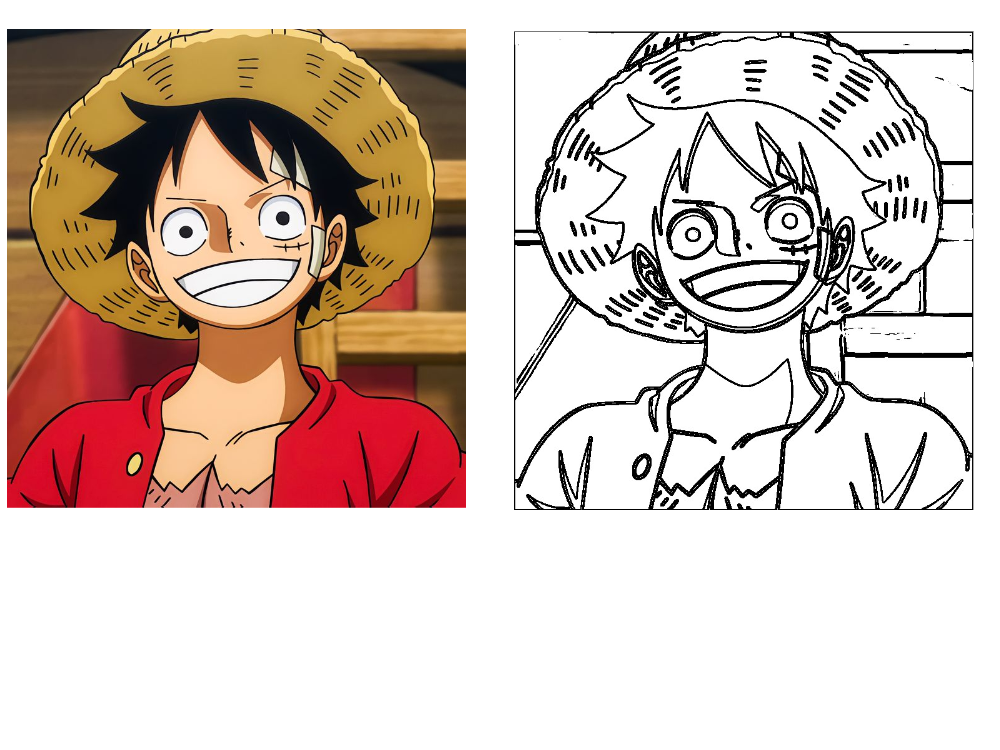
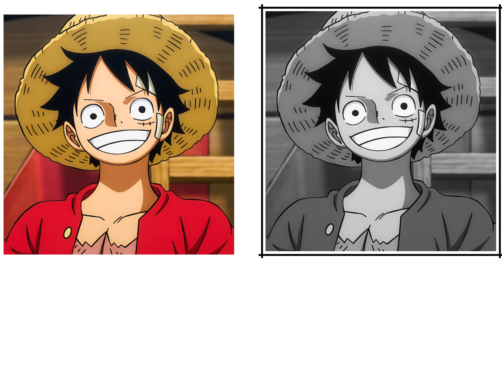

# Baby Photoshop v0

A C++ image editor that provides different image processing and editing features in a simple manner.

## Team

* [Bavly Boules](https://github.com/bavlybbb12)
* [Bemwa Bakhet](https://github.com/Boggos009)
* [Zeyad Sayed](https://github.com/ZeyadSayed-Dev)
* [Martin Rashad](https://github.com/CrywareEngineer)

## Features

### Image Operations

* Load a new image
* Save edited images
* Undo the last filter
* Restore the last original image loaded

### Filters

1. Grayscale Conversion
2. Black and White
3. Invert Image
4. Add a Frame
5. Flip Image
6. Rotate Image
7. Darken and Lighten Image
8. Resize Image
9. Merge Images
10. Detect Image Edges
11. Crop Image
12. Blur Image
13. Wano Natural Sunlight
14. Wano Old TV
15. Purple Wano
16. Infrared Photography
17. Skew Image
18. Oil Painting

## Technologies

* C++
* Image Processing
* Git & GitHub

## Description

Baby Photoshop v0 is a simple C++ image editor developed as a team project.

The application allows users to load images, apply different image processing filters, undo changes, restore the original image, and save their final edits.

## Some Samples

    <b>Edge Detection</b>
  

    <b>Grayscale + Frame</b>
  

